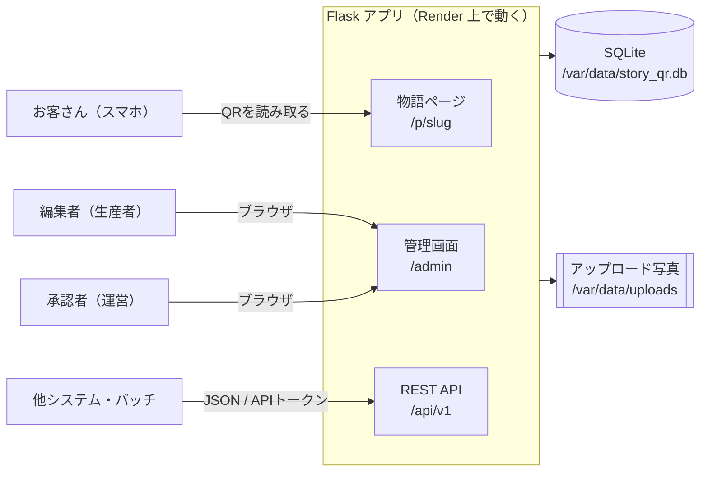
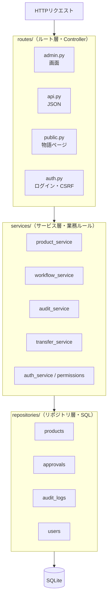
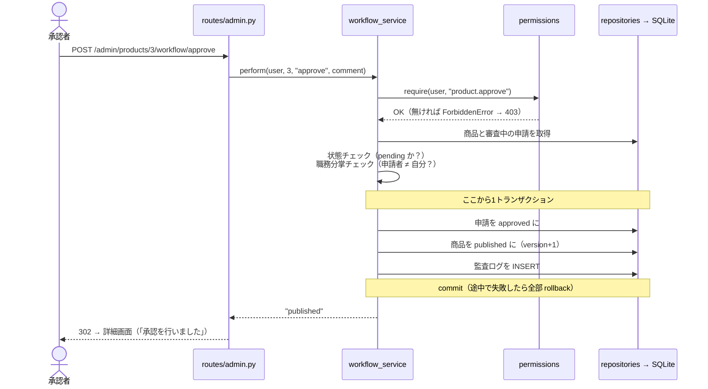
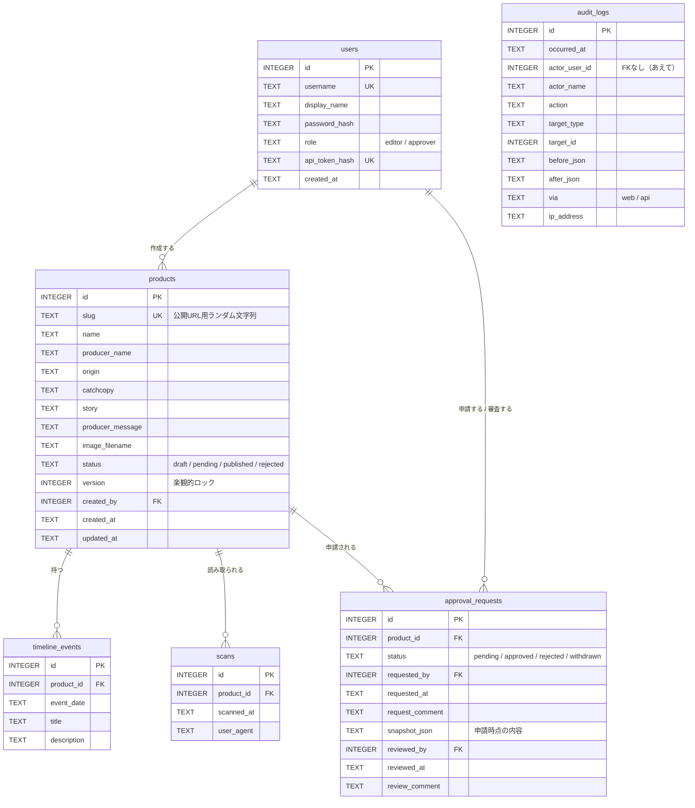
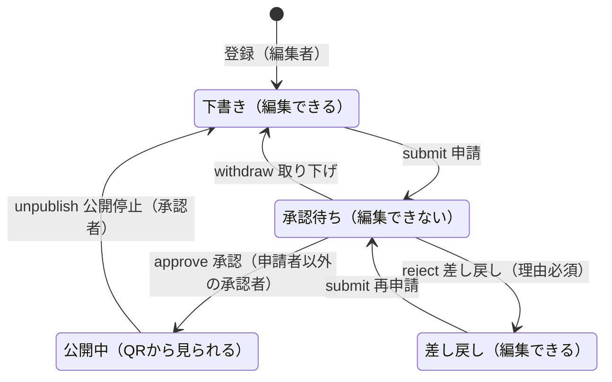
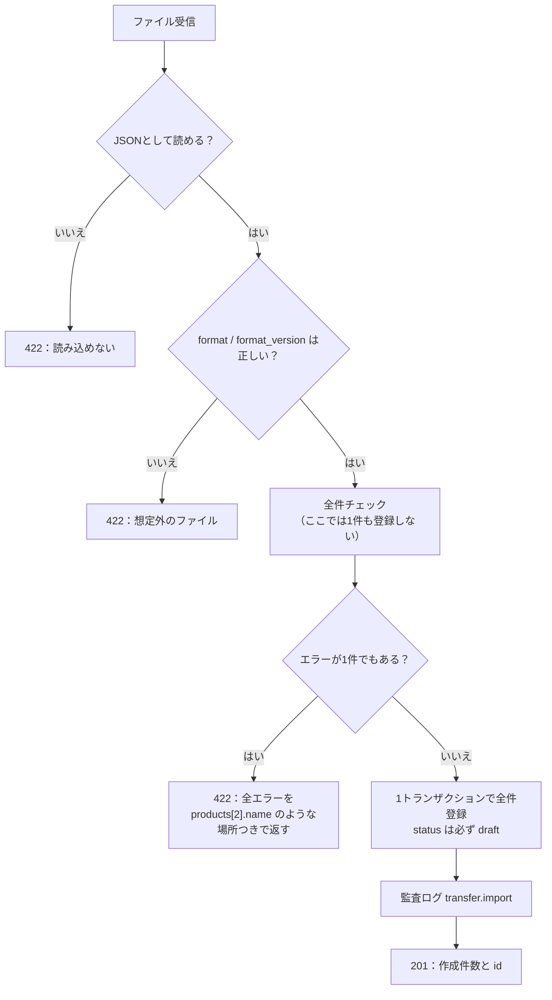

# 設計書 — この商品の物語 QR サービス

このドキュメントは「コードを読む前に全体像をつかむ」ためのものです。
実務の **申請・承認システム / REST API / ファイル連携** でもそのまま使える考え方で書いています。

> VS Code で図を表示するには、拡張機能「Markdown Preview Mermaid Support」を入れて、このファイルを開いた状態で `Ctrl+Shift+V`（Mac は `⌘+Shift+V`）を押してください。

---

## 目次

1. [全体像（システム構成）](#1-全体像システム構成)
2. [アーキテクチャ（3層構造）](#2-アーキテクチャ3層構造)
3. [DB設計](#3-db設計)
4. [申請・承認フロー（状態遷移）](#4-申請承認フロー状態遷移)
5. [権限設計（ロール）](#5-権限設計ロール)
6. [監査ログ設計](#6-監査ログ設計)
7. [REST API 設計](#7-rest-api-設計)
8. [ファイル連携（JSON）設計](#8-ファイル連携json設計)
9. [排他制御（楽観的ロック）](#9-排他制御楽観的ロック)
10. [セキュリティ対策](#10-セキュリティ対策)
11. [次の案件との対応表](#11-次の案件との対応表)

---

## 1. 全体像（システム構成）



| 利用者 | 使う画面・機能 | 認証方法 |
|---|---|---|
| お客さん | 物語ページ | なし（公開ページ） |
| 編集者 | 商品の登録・編集・承認申請 | ユーザー名＋パスワード（Cookie セッション） |
| 承認者 | 上記＋承認・差し戻し・削除・監査ログ | 同上 |
| 他システム | REST API | APIトークン（`Authorization: Bearer ...`） |

---

## 2. アーキテクチャ（3層構造）



| 層 | フォルダ | やること | やらないこと | Java/Spring だと |
|---|---|---|---|---|
| ルート層 | `routes/` | リクエストから値を取り出す／サービスを呼ぶ／HTML・JSONで返す | 業務ルール、SQL | `@Controller` / `@RestController` |
| サービス層 | `services/` | 権限チェック、状態チェック、入力チェック、**トランザクション**、監査ログ | 画面の都合（flash、HTML） | `@Service` |
| リポジトリ層 | `repositories/` | SQL を実行する | commit、業務ルール | `@Repository` / MyBatis Mapper |

**なぜ分けるのか**：画面（`admin.py`）と API（`api.py`）が **同じサービスの関数** を呼ぶので、
「画面からはできないのに API からはできてしまう」といったルールのズレが起きません。

### 1つのリクエストの流れ（例：承認ボタン）



---

## 3. DB設計

### ER図



監査ログ（`audit_logs`）だけは、どの表とも線（外部キー）でつないでいません。理由は [6. 監査ログ設計](#6-監査ログ設計) で説明します。

### テーブル定義（主なもの）

**products（商品）**

| 列 | 型 | 必須 | 説明 |
|---|---|---|---|
| id | INTEGER | ○ | 主キー（自動採番） |
| slug | TEXT | ○ | 公開URL `/p/<slug>`。連番だと他商品のURLを推測されるのでランダム。UNIQUE |
| name | TEXT | ○ | 商品名（100文字以内） |
| producer_name | TEXT | ○ | 生産者名（100文字以内） |
| origin / catchcopy / story / producer_message | TEXT |  | 産地・キャッチコピー（60）・物語（5000）・ひとこと（1000） |
| status | TEXT | ○ | 状態。CHECK 制約で4種類以外は保存できない |
| version | INTEGER | ○ | 更新のたびに +1。同時編集の検知に使う |
| created_by | INTEGER |  | 作成者（users.id） |

**approval_requests（申請）** — 申請1回につき1行。差し戻し→再申請すると行が増えるので、履歴がすべて残ります。

| 列 | 説明 |
|---|---|
| status | `pending`（審査中）→ `approved` / `rejected` / `withdrawn` のどれかで確定 |
| snapshot_json | **申請した瞬間の商品内容（JSON）**。「承認者は何を見て承認したのか」を後から証明できる |
| requested_by / reviewed_by | 申請者・審査者。職務分掌のチェックに使う |

### 設計で意識したこと

| 考え方 | このアプリでの例 |
|---|---|
| 制約は DB にも書く | `CHECK (status IN (...))`、`UNIQUE`、`NOT NULL`。アプリにバグがあっても変なデータが入らない最後の砦 |
| 1対多は子に外部キー | `timeline_events.product_id → products.id` |
| 親を消したら子も消す | `ON DELETE CASCADE`（商品を消すと記録・読み取りログも消える） |
| 消してはいけないものはつながない | 監査ログは外部キーなし |
| 検索条件にはインデックス | `status`、`(target_type, target_id)` など |
| 日時は文字列（ISO形式）で統一 | `2026-10-28 23:59:00`。SQLite には日時型がないため |

---

## 4. 申請・承認フロー（状態遷移）

### 状態遷移図



### 状態遷移表（`services/workflow_service.py` の `TRANSITIONS`）

| 操作 | できる状態 | 次の状態 | 必要な権限 | 追加ルール |
|---|---|---|---|---|
| submit（申請） | draft, rejected | pending | product.submit | 物語の本文が必要。申請時点の内容をスナップショット保存 |
| withdraw（取り下げ） | pending | draft | product.withdraw | |
| approve（承認） | pending | published | product.approve | **申請者本人は不可（職務分掌）** |
| reject（差し戻し） | pending | rejected | product.reject | 申請者本人は不可。**理由（コメント）必須** |
| unpublish（公開停止） | published | draft | product.unpublish | |

- 表にない組み合わせはすべて **409 Conflict**（例：下書きをいきなり承認）
- 編集できるのは `draft` と `rejected` だけ（承認した内容が、承認後に勝手に変わらないように）

### 実装のポイント

```python
# if 文を並べる代わりに「表」で持つ
TRANSITIONS = {
    "submit":  {"from": {"draft", "rejected"}, "to": "pending",   "permission": "product.submit"},
    "approve": {"from": {"pending"},           "to": "published", "permission": "product.approve"},
    ...
}
```

状態や操作が増えても、この表に1行足すだけで済みます。設計書の表とコードが1対1で対応するので、レビューもしやすくなります。

---

## 5. 権限設計（ロール）

`services/permissions.py` の `ROLE_PERMISSIONS`（RBAC：ロールベースアクセス制御）

| 権限 | 編集者 editor | 承認者 approver |
|---|:---:|:---:|
| product.write（登録・編集・記録） | ○ | ○ |
| product.submit / withdraw（申請・取り下げ） | ○ | ○ |
| transfer.import（JSON取り込み） | ○ | ○ |
| product.approve / reject（承認・差し戻し） | | ○ |
| product.unpublish（公開停止） | | ○ |
| product.delete（削除） | | ○ |
| audit.read（監査ログ閲覧） | | ○ |

- **画面でボタンを隠す** ＋ **サーバーでも必ずチェックする** の二重構え。
  ボタンを隠すだけだと、URL を直接叩かれたら通ってしまうため（「画面を信用しない」）。
- 認証（あなたは誰？）は `auth_service.py`、認可（それをしていい？）は `permissions.py` と分けています。

---

## 6. 監査ログ設計

### 何を記録するか

| action | いつ | before / after |
|---|---|---|
| auth.login / auth.login_failed | ログイン成功・失敗 | 失敗時は入力されたユーザー名 |
| auth.issue_token | APIトークン発行 | — |
| product.create | 登録 | after：登録内容 |
| product.update | 編集 | **変わった項目だけ** before / after |
| product.delete | 削除 | before：削除した内容まるごと |
| product.submit / approve / reject / withdraw / unpublish | 状態の変更 | status とコメント |
| timeline_event.create / delete | 記録の追加・削除 | 記録の内容 |
| transfer.export / transfer.import | ファイル連携 | 件数・作成された id |

### 設計の原則

1. **業務データの変更と同じトランザクションで書く**
   → 「データは変わったのにログが無い」「ログはあるのにデータが変わっていない」が起きない
2. **追記のみ（Append-only）**
   → リポジトリに `insert` と `search` しか作っていない。画面にも削除ボタンは無い
3. **外部キーを付けない＆名前をコピーして持つ**
   → 商品やユーザーが削除されても、ログは残り「誰が」も読める
4. **差分だけ残す**
   → `audit_service.diff()` で変わった項目だけを抽出。読みやすく、容量も小さい
5. **経路（web / api）と IP を残す**
   → 「画面から操作されたのか、他システムから来たのか」を区別できる

---

## 7. REST API 設計

ベースURL：`/api/v1`　認証：`Authorization: Bearer <APIトークン>`　形式：JSON（UTF-8）

| メソッド | パス | 説明 | 成功時 |
|---|---|---|---|
| GET | `/me` | 自分の情報 | 200 |
| GET | `/products?status=` | 商品一覧 | 200 |
| POST | `/products` | 商品登録（下書き） | **201** ＋ `Location` ヘッダー |
| GET | `/products/{id}` | 商品詳細（記録つき） | 200 |
| PATCH | `/products/{id}` | 一部更新（`version` 必須） | 200 |
| DELETE | `/products/{id}` | 削除（承認者） | **204**（本文なし） |
| GET | `/products/{id}/events` | 記録一覧 | 200 |
| POST | `/products/{id}/events` | 記録追加 | 201 |
| DELETE | `/events/{id}` | 記録削除 | 204 |
| POST | `/products/{id}/submit` | 申請 | 200 |
| POST | `/products/{id}/withdraw` | 取り下げ | 200 |
| POST | `/products/{id}/approve` | 承認 | 200 |
| POST | `/products/{id}/reject` | 差し戻し（`comment` 必須） | 200 |
| POST | `/products/{id}/unpublish` | 公開停止 | 200 |
| GET | `/approval-requests?status=` | 申請一覧 | 200 |
| GET | `/audit-logs?action=&target_type=&target_id=&limit=` | 監査ログ（承認者） | 200 |
| GET | `/export` | JSONファイルでエクスポート | 200 |
| POST | `/import` | JSON取り込み（ボディ or `file`） | 201 |

### ステータスコードの使い分け

| コード | 意味 | このAPIで返す場面 |
|---|---|---|
| 200 OK | 成功 | 取得・更新・ワークフロー操作 |
| 201 Created | 作成した | 商品・記録の登録、インポート |
| 204 No Content | 成功・返すものなし | 削除 |
| 401 Unauthorized | 誰か分からない | トークンなし・間違い |
| 403 Forbidden | 誰かは分かるが権限なし | 編集者が承認、自分の申請を承認 |
| 404 Not Found | 対象がない | 存在しない id |
| 409 Conflict | 今の状態ではできない | 承認待ちを編集、古い version で更新 |
| 422 Unprocessable Entity | 入力が不正 | 必須項目なし、日付形式が違う |

### エラーの形（全APIで統一）

```json
{
  "error": {
    "code": "VALIDATION_ERROR",
    "message": "入力内容に誤りがあります。",
    "details": [
      { "field": "name", "message": "商品名は必須です。" },
      { "field": "catchcopy", "message": "60文字以内にしてください。" }
    ]
  }
}
```

`code` は機械が判定するため（英大文字固定）、`message` は人が読むため、`details` は入力欄ごとの表示に使います。
実装は `errors.py` の例外クラス → `routes/api.py` の `handle_app_error` で一括変換しています。

### 設計のコツ（このAPIで守っていること）

- URL は **名詞の複数形**（`/products`）。動詞は HTTP メソッドで表す
- 「承認」のような CRUD に当てはまらない操作は `POST /products/{id}/approve` の形にする
- バージョンを URL に入れる（`/v1`）。互換性のない変更は `/v2` を作る
- レスポンスは DB の行をそのまま返さず、`to_dict()` で「外に見せる形」に詰め替える
- 画面用の Cookie では API を使えない（トークン必須）。CSRF の心配をなくすため

---

## 8. ファイル連携（JSON）設計

### ファイル形式（`format_version: 1`）

```json
{
  "format": "story-qr-products",
  "format_version": 1,
  "exported_at": "2026-10-28T12:00:00",
  "products": [
    {
      "name": "…", "producer_name": "…", "origin": "…",
      "catchcopy": "…", "story": "…", "producer_message": "…",
      "events": [ { "event_date": "2026-04-28", "title": "…", "description": "…" } ]
    }
  ]
}
```

サンプル：[`docs/sample-import.json`](sample-import.json)

### 取り込み処理の流れ



### ファイル連携の設計ポイント

| ポイント | 理由 |
|---|---|
| ヘッダー情報（`format`, `format_version`）を持たせる | 違うファイルを間違って取り込む事故を防ぐ。形式を変えるときは version を上げる |
| **オール・オア・ナッシング** | 途中まで登録されると、どこから再送すればいいか分からなくなる |
| エラーは「全部」「場所つき」で返す | 1件直して再送→また別のエラー、の往復を減らす |
| 取り込んだデータは下書き | 外部データをそのまま公開せず、承認フローを必ず通す |
| 件数上限（500件） | 巨大ファイルでサーバーが固まるのを防ぐ |
| エクスポート・インポートも監査ログに残す | 「いつ、誰が、何件やり取りしたか」を追える |

---

## 9. 排他制御（楽観的ロック）

**問題**：A さんと B さんが同じ商品の編集画面を開き、A さんが保存 → B さんが保存すると、A さんの変更が消える（「後勝ち」問題）。

**対策**：`products.version` を使う。

```sql
UPDATE products SET ..., version = version + 1
WHERE id = :id AND version = :画面を開いたときのversion
```

- 更新できた行数が **0** なら、誰かが先に更新している → **409 Conflict** を返す
- 画面ではフォームに `<input type="hidden" name="version">` を入れて送る
- API では `PATCH` のボディに `"version": 3` を入れてもらう

「ロック（鍵）をかけずに、保存のときにぶつかっていないか確かめる」ので **楽観的** ロックと呼びます。
業務システムではとてもよく使われる方式です。

---

## 10. セキュリティ対策

| 脅威 | 対策 | 場所 |
|---|---|---|
| SQLインジェクション | SQL に値を直接つなげず `?` / `:name` のプレースホルダを使う | `repositories/` 全体 |
| XSS（スクリプト埋め込み） | Jinja2 の自動エスケープ。`| safe` を使わない。改行は CSS で表示 | `templates/` |
| CSRF（なりすまし送信） | フォームに合言葉トークンを入れて POST ごとに照合 | `routes/auth.py` |
| パスワード漏えい | ハッシュ化して保存（werkzeug） | `auth_service.py` |
| APIトークン漏えい | SHA-256 ハッシュで保存、表示は発行時の1回だけ、再発行で旧トークン無効 | `auth_service.py` |
| セッション固定攻撃 | ログイン時に `session.clear()` | `routes/auth.py` |
| オープンリダイレクト | `next` は自サイト内（`/` 始まり）のみ許可 | `routes/auth.py` |
| 推測可能なURL | 公開URLはランダム文字列（slug） | `product_service._new_slug` |
| 危険なファイル名 | 保存時にランダムな名前を付け直す。拡張子を制限。5MB 上限 | `product_service.save_image` |
| 秘密情報のコミット | 環境変数で設定。本番で初期値のままなら起動しない | `config.py` / `app.py` |
| Cookie の盗聴 | 本番は `Secure`・`HttpOnly`・`SameSite=Lax` | `config.py` |

---

## 11. 次の案件との対応表

| 案件で担当すること | このアプリで対応する場所 | まず読むところ |
|---|---|---|
| JSONベース通信 / REST API開発 | `routes/api.py`、`errors.py` | 7章、`api.http` を実際に叩く |
| DB設計 | `schema.sql` | 3章の ER図・テーブル定義 |
| システム間のファイル授受 | `services/transfer_service.py` | 8章 |
| 申請・承認フロー | `services/workflow_service.py` | 4章の状態遷移図と表 |
| 監査機能 | `services/audit_service.py`、`repositories/audit_logs.py` | 6章 |
| 権限 | `services/permissions.py` | 5章 |
| トランザクション | `db.py` の `transaction()` | 2章のシーケンス図 |
| 排他制御 | `repositories/products.py` の `update()` | 9章 |
| テスト | `tests/test_app.py` | テスト名がそのまま仕様になっている |

### 実務の案件では、ここがさらに発展します

- **承認の多段化**：課長承認 → 部長承認 のように段階が増える（`approval_steps` 表を作り、順番を持たせる）
- **代理承認・承認者の自動決定**：組織マスタから承認ルートを決める
- **変更申請**：公開中の内容を残したまま「変更案」だけを申請する（このアプリでは一度下書きに戻す簡易版）
- **ファイル連携の非同期化**：大きいファイルは受付だけしてバッチで処理し、結果を後から取得する
- **監査ログの改ざん防止**：ハッシュチェーン、別DBへの転送、保存期間の管理
- **API仕様書**：OpenAPI（Swagger）で書いて、他チームと共有する
